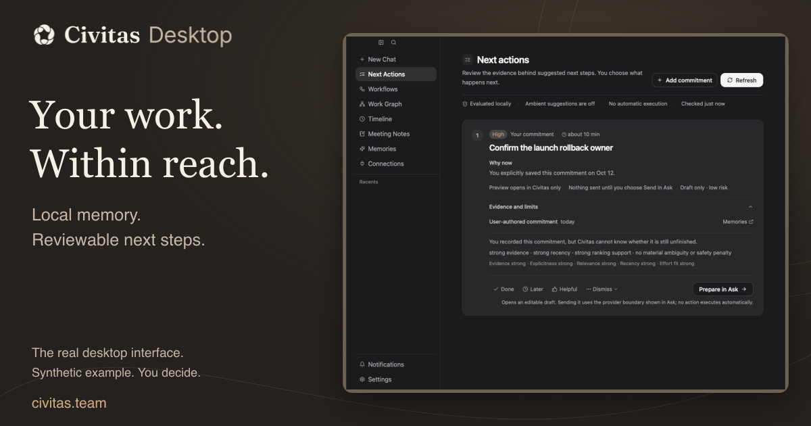
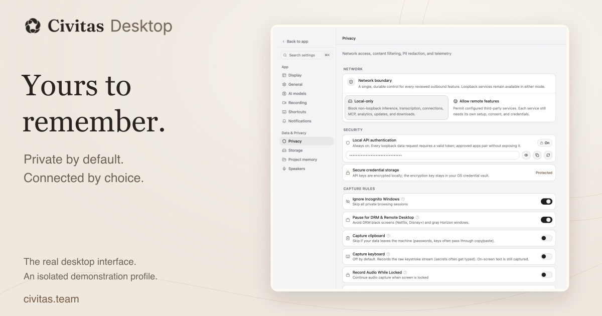

# Visual gallery and sources

These images present the real Civitas Desktop interface in complete native
windows. The wordmark, typography, backgrounds, and shadows frame the captures;
the app's pixels remain intact. Example work comes from an isolated test
profile with recording disabled.

## Gallery

The main README opens with Next Actions and follows the journey through
Timeline, Privacy, and AI settings. Each feature image links to its original
PNG, so the navigation, selected settings, and surrounding controls can be
inspected together.

| View | Presentation | Original native capture |
| --- | --- | --- |
| Next Actions, light | [Light hero](hero-light.svg) · [Feature view](shot-next-actions.svg) | [Light window](../demo/next-actions.png) |
| Next Actions, dark | [Dark hero](hero-dark.svg) | [Dark window](../demo/next-actions-dark.png) |
| Timeline | [Feature view](scene-timeline.svg) | [Timeline window](../demo/timeline.png) |
| Privacy | [Feature view](shot-privacy.svg) | [Privacy window](../demo/privacy.png) |
| AI settings | [Feature view](shot-ai-providers.svg) | [AI settings window](../demo/ai-providers.png) |

Next Actions keeps the proposed step, its reason, and the evidence together.

[](../demo/next-actions.png)

### Share images

Both share cards are 1200 × 630 pixels. Each includes a complete native window;
the feature views above provide a larger reading size.

[](share-context.png)

[Context PNG](share-context.png) · [Editable SVG](share-context.svg)

[](share-privacy.png)

[Privacy PNG](share-privacy.png) · [Editable SVG](share-privacy.svg)

The [light](how-it-works-light.svg) and [dark](how-it-works-dark.svg)
architecture diagrams explain the data flow. They are illustrations, separate
from the native interface captures.

## Native capture provenance

The five captures come from the successful
[native publication run 38205609866](https://github.com/civitass/civitas-desktop/actions/runs/38205609866),
built from commit
[`609b58e29bc6da90e4d144c4395d2b0e2f52a21b`](https://github.com/civitass/civitas-desktop/commit/609b58e29bc6da90e4d144c4395d2b0e2f52a21b).

The dedicated [publication workflow](../../../.github/workflows/publication-visuals.yml)
configures the hosted Mac display before launching Civitas. The scenario
requests 1120 × 900 native windows for Next Actions and Timeline, and
1120 × 1000 for Settings. It selects the app's **X-Large / 16px** display
setting through its real controls. It checks the available viewport
and key controls before capture. The [manifest](manifest.json) records the
actual PNG dimensions, source hashes, and presentation placements; requested
window size is not a substitute for those measurements.

All five images come from
[`publication-demo.spec.ts`](../../../apps/civitas-app-tauri/e2e/specs/publication-demo.spec.ts)
in the `publication-visuals-macos-609b58e29bc6da90e4d144c4395d2b0e2f52a21b`
artifact:

| Original | Measured pixels | Artifact filename | Scenario checks |
| --- | --- | --- | --- |
| [Next Actions, light](../demo/next-actions.png) | 1120 × 900 | `publication-next-actions.png` | Creates or reuses the synthetic “Confirm the launch rollback owner” commitment, refreshes local ranking, and expands its evidence. |
| [Next Actions, dark](../demo/next-actions-dark.png) | 1120 × 900 | `publication-next-actions-dark.png` | Selects Dark in the real Display settings, then returns to the same Next Actions example. |
| [Timeline](../demo/timeline.png) | 1120 × 900 | `publication-timeline.png` | Seeds three frames in the isolated library and verifies the normal Timeline loads the synthetic launch document and complete time labels. |
| [Privacy](../demo/privacy.png) | 1120 × 1000 | `publication-privacy.png` | Verifies the section starts at its top, Local-only is selected, API authentication is locked on, and the local key remains masked. |
| [AI settings](../demo/ai-providers.png) | 1120 × 1000 | `publication-ai-settings.png` | Selects Local only and verifies the complete setup controls, without entering credentials or sending a prompt. |

All four publication scenarios passed. This dedicated capture workflow is
separate from the complete E2E release gate; it does not replace that gate.

The E2E launcher uses a separate `.e2e` data directory and the
`onboarding,no-recording` seed. The examples contain no personal capture,
customer conversation, or usable credential. Light and dark captures come
from actual theme changes; their interface colors are not retouched.

### The document inside Timeline

The Northstar launch brief is synthetic work content, not an additional
Civitas screen. Its source is
[`publication-timeline-document.html`](../../../apps/civitas-app-tauri/e2e/fixtures/publication-timeline-document.html),
rendered as
[`publication-timeline-frame.png`](../../../apps/civitas-app-tauri/e2e/fixtures/publication-timeline-frame.png).
An E2E-only command places that image in the isolated database and frame cache.
The real Timeline retrieves it through the ordinary application path.

The surrounding navigation, date controls, app context, and time scrubber
belong to Civitas. Northstar, the launch handoff, and its named participants
are demonstration data.

## Presentation method

[`readme-art-direction.mjs`](../../../scripts/lib/readme-art-direction.mjs)
composes each complete capture using uniform scaling. It does not crop the
interface, repaint labels, hide controls, or combine separate settings into a
fabricated screen. Borders and shadows sit outside the source image. The hero
uses the existing Civitas wordmark with a headline and one complete Next
Actions window.

Each capture preserves the visible native viewport. Scrollable settings can
continue below it; a complete window does not imply the whole settings page
fits on one screen.

The [generated manifest](manifest.json) connects each presentation to its
source image and records dimensions and hashes. Credential protection shown
in Privacy applies to keys; it is not a claim that every captured image or
database is encrypted. The [privacy boundary](../../PRIVACY_AND_DATA_BOUNDARY.md)
describes the storage contract.

## Regenerate the artwork

Install the locked frontend dependencies first; the renderer uses the app's
pinned Sharp dependency. From the repository root:

```bash
cd apps/civitas-app-tauri
bun install --frozen-lockfile
cd ../..
bun scripts/generate-readme-visuals.mjs
bun scripts/generate-readme-visuals.mjs --check
```

SVG generation is reproducible byte for byte. Share-PNG rasterization uses
the rendering host's fonts, so a different host can produce different PNG
bytes. `--check` compares regenerated SVG sources, verifies native-source
hashes, and checks the existing share PNGs against their reviewed manifest
hashes and 1200 × 630 dimensions without rerasterizing them.

Regeneration reuses the checked-in captures; it does not launch Civitas or
prove a newer interface. Review the README at normal and narrow widths in
both themes, then inspect the original PNGs for readable labels, complete
windows, truthful settings, and masked credentials.

## Capture a newer interface

Use the dedicated [publication workflow](../../../.github/workflows/publication-visuals.yml)
to reproduce the display setup and isolated journey. Local capture requires
the [platform build prerequisites](../../BUILDING.md), a compiled E2E app,
and a graphical session large enough to show the whole window. See the
[E2E guide](../../../apps/civitas-app-tauri/e2e/README.md) for launcher details.

From `apps/civitas-app-tauri`, after preparing the platform dependencies and
display:

```bash
bun install --frozen-lockfile
NEXT_PUBLIC_CIVITAS_E2E=true bun tauri build --no-sign --debug --no-bundle -- --features e2e
CIVITAS_E2E_SEED=onboarding,no-recording CIVITAS_PUBLICATION_CAPTURE=1 \
  bun run wdio run e2e/wdio.conf.ts --spec e2e/specs/publication-demo.spec.ts
```

The scenario uses real Display settings, provider choices, and commitment
forms. It restores the previous display preferences and window size on
completion. Screenshots are written to `e2e/screenshots/`; CI uploads them
with display diagnostics and a source manifest.

Before replacing assets, verify the scenario passed and inspect every PNG.
Record the immutable commit, workflow run, platform, measured dimensions, and
hashes in the provenance inputs to
[`generate-readme-visuals.mjs`](../../../scripts/generate-readme-visuals.mjs),
then regenerate the presentation. The manifest is generated output; do not
edit it by hand. Keep fixture content identified and preserve complete native
windows in future revisions.
